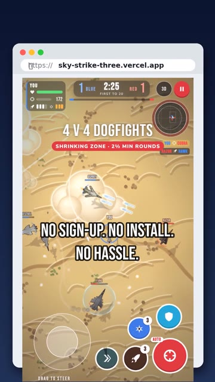

# SKY STRIKE

**Team Catalyst Minds · Calcutta AI Club Vibe Coders Hackathon (Ed. 3)**

## ▶ Play now

**[sky-strike-three.vercel.app](https://sky-strike-three.vercel.app)** — free in your browser, on phone or laptop. No sign-up, no install. Tap **PLAY WITH A FRIEND** to fly online together using a 6-letter room code.

## 🎬 Demo video

**SKY STRIKE — Official Launch Trailer (60 s)**

[](media/SKY-STRIKE-promo-reel.mp4)

[Watch the trailer (MP4, 1080×1920)](media/SKY-STRIKE-promo-reel.mp4) · real gameplay footage, vertical format for Instagram Reels.

---


A portrait, top-down arcade dogfighter for desktop and mobile browsers. Fly ten
fictional fighter jets against nine kinds of enemy aircraft over open sky,
mountains, desert, snowfields and a burning battlefield. Every enemy carries guns
and homing missiles; you answer with a manual cannon, your own missiles, flares,
an afterburner boost and a special attack across a fifteen-mission campaign with
three boss battles and five upgrade tracks per aircraft.

All aircraft names and designs are fictional, and all art, audio and interface
design are original to this project.

Plain HTML5 Canvas + CSS + JavaScript (ES modules) + Web Audio. No framework,
no runtime dependencies, no external assets.

## The story: Operation Firebreak

The Crimson Wing, a rogue air armada led by **Warlord Kael Vex**, has seized the skies over the
Coral Coast and grounded every civilian flight. **Phoenix Squadron** is the last free fighter wing.
You are its newest pilot, call sign **Ember** (or your own call sign), flying beside **Falcon**
(cocky, fast) and **Hawk** (steady), under **Captain Rhea Sen**.

- **Act I - The Rookie (missions 1-4):** first flights over the coast and the capital; Vex notices you.
- **Act II - Counter-attack (5-10):** the Storm Carrier falls, Falcon is shot down and rescued,
  the Dreadnought goes down over the volcano.
- **Act III - The Warlord (11-15):** Vex escapes and regroups; the final duel over the burning front.

The story is told through an **opening cinematic** (formation fly-past, story lines, logo slam),
**mission briefings** with a quote from the speaker, and **in-mission radio** with portraits and
subtitles (`src/story/script.js`, about 60 lines, including Team Battle chatter). Lines are spoken
with the browser's voices; recorded voice files (ElevenLabs) are used automatically when added:
put `voices/<line id>.mp3` in the project and run `node tools/voices.mjs && npm run build`.

## v8: live online play with a friend (no sign-in)
Create a room in setup, PLAY WITH A FRIEND. Share the 6-letter code or link. CO-OP or VERSUS. See HANDOFF.md for details.

## What's new in v7

- **Take-off from Phoenix Air Base:** every battle and campaign mission now starts on the ground, with hangars, a control tower, fuel tanks, a helipad and parked jets. The squadron rolls down the runway and rotates. As it climbs, the ground shrinks away. The jets then punch through a cloud layer into the war sky as FIGHT! lands.
- **Target lock:** amber brackets spin and close on the enemy in your missile cone. A progress bar fills, then the brackets snap to a red LOCKED diamond with a lock tone. Missiles fire at the locked target.
- **Combat zoom:** while you are locked and close to the target, the camera eases in about 12% and frames you and your target together.
- **Opt-out:** lock and zoom are both on by default. Turn them off with Settings → Controls → "Target-lock animation & combat zoom".
- **Polish:**
  - Gunfire is crisper and has varied pitch.
  - Afterburner and gear-up sounds play during take-off.
  - The cloud punch has a whoosh.
  - The "outside zone" warning no longer shows during take-off.

## Campaign upgrades

Terrain under every mission (Coral Coast ocean, the capital by day and at night, desert,
mountains, volcano), plane shadows, light blooms, colour grading, intro push-in with letterbox,
a **radar map** (Settings > Radar map) and, in boss fights only, a **closing arena** so the duel
cannot turn into an endless chase. All jets are drawn 15% larger with an outline (hitboxes match).

## Team Battle

A short, arcade **4 v 4 dogfight** for pick-up-and-play sessions: you and 3 AI wingmen vs 4 AI.

- **One round is 2:30**; first team to 20 kills wins, a tie goes to 20 s of sudden death.
- **6 battlegrounds**, each with its own painted terrain, colour grade and zone colour:
  Desert Storm, Ocean Strait (islands, reefs, ships), Metro City (rooftops, river, traffic),
  Frozen Peaks, Volcano (lava rivers) and Warzone. Easy / Normal / Hard bots.
- **Shrinking zone** in four steps; outside it your jet burns. The next circle is shown on the
  battlefield and on the radar minimap.
- **Energy shield** (R or the blue button): blocks every bullet and missile for 3.5 s,
  then recharges for 15 s. Bots use it too.
- **Limited weapons:** 180 rounds per life, a gun that overheats after ~15 rounds of
  continuous fire, 3-6 missiles and 3 flares per life; supply crates bring more.
- **Controls you can change** (Settings > Controls, or the CONTROLS button on the battle
  screen): every keyboard key (two per action), fire mode AUTO / HOLD / TOGGLE, auto flares.
  Bindings are shared with the campaign.
- **Invite / challenge links:** "Invite a friend" and "Challenge a friend" (on the results
  screen) make a link with your battleground, skill level and kill count. Your friend opens
  it, lands in the same battle setup, and sees "challenge won/lost" after their round.
  Links need the game to be hosted online (a copy opened from a file only works on that
  device). This is not live multiplayer: each player flies their own round.
- **Squad size:** 2v2, 3v3 (default) or 4v4; jets fly 16% slower than in the campaign and enemy
  labels only appear when they matter, so the fight is easy to read.
- **Cockpit view (V or the 3D button):** a first-person view with a fighter-jet HUD (heading tape,
  airspeed and altitude, pitch ladder, flight-path marker, target diamond with range, G-meter),
  radar and stores displays, a cloud deck below, turbulence and G-force grey-out. Left/right turns
  the nose, up/down is throttle. The simulation is the same 2D battle, drawn in perspective.
- **Phone controls:** floating stick on the left (works even if your thumb is already down
  during the countdown, and the ring follows your thumb), fire / missile / shield / boost /
  flares on the right, full multi-touch.
- **Cinematic presentation:** letterbox intro and push-in camera, 3-2-1-FIGHT, hit-stop and
  slow motion on kills, kill cam, plane shadows on the ground, foreground cloud wisps, light
  bloom, colour grading, vignette, speed lines, damage flashes / smoke / fire.

Code: `src/battle/` (BattleWorld, Fighter, BotBrain, Zone, BattleInput, Invite, battleData),
`src/ui/BattleUI.js`, `src/ui/ControlsUI.js`, `src/systems/Keybinds.js`, `src/systems/TouchStick.js`.
Tuning lives in `src/battle/battleData.js`.

**Laptops:** landscape windows use the whole screen. Portrait phones are unchanged.

## Run it

**Quickest:** open `dist/sky-strike.html` in any modern browser. It is the whole
game in one file and works straight from disk.

**From source** (ES modules need a web server, they do not load from `file://`):

```bash
cd sky-strike
python3 -m http.server 8080      # or: npx serve .
# open http://localhost:8080
```

**Rebuild the single-file version** after changing code:

```bash
npm install        # once - installs esbuild
npm run build      # writes dist/sky-strike.html
```

## Developer build

`dist/sky-strike-dev.html` is the same game with all 15 missions open, all ten
aircraft owned and 999,999 coins. Settings gains two extra switches: Invincible
and Max all upgrades. It saves to its own slot, so it never changes progress in
the normal game. From source, add `?dev=1` to the URL for the same effect. Do not
publish this file to players.

## Controls

| Action | Keyboard | Touch |
| --- | --- | --- |
| Steer | WASD or arrow keys | Drag the stick (it appears under your thumb) |
| Fire cannon | Hold Space or J | Hold CANNON |
| Homing missile | K | MISSILE button |
| Special attack | L or E | SPECIAL button |
| Flares (decoy enemy missiles) | F or Q | FLARES button |
| Boost (short burst of speed and tighter turning) | Shift or B | BOOST button |
| Pause | Esc or P | Pause button |

Team Battle adds **Energy shield: R** (touch: blue button). Every key can be changed in
Settings > Controls.

Your aircraft always flies forward; you steer it. The cannon is manual: it fires
only while the trigger is held, with a slight aim assist. When the MISSILE
warning shows, pop flares or turn hard - enemy missiles turn slowly.

## Deploy online

The game is static files, so any static host works:

- **GitHub Pages:** push this folder to a repository, then Settings > Pages >
  deploy from the main branch root.
- **Netlify / Vercel / Cloudflare Pages:** drag the folder in, or connect the
  repository. No build command, publish directory is the project root.
- **Anything else:** upload `dist/sky-strike.html` on its own and rename it
  `index.html`.

## Project structure

```
index.html, style.css, main.js   page shell, interface styles, entry point
assets/fonts/                    Bebas Neue + Nunito (SIL Open Font License)
src/core/      Game (state machine), GameLoop, GameState, GameConfig, World (one mission), Ambient (menu sky)
src/player/    Player, PlayerController, WeaponSystem
src/enemies/   Enemy, EnemyManager, EnemyAI (movement + shooting patterns), Boss (phases)
src/combat/    Projectile, Missile, Flare, CollisionSystem, Explosion, Pickup, Trail
src/systems/   LevelManager, RewardManager, UpgradeManager, SaveManager, AudioManager,
               VFXManager, InputManager, ObjectPool, Background, Terrain (landscapes)
src/ui/        UI (screen manager), MenuUI, LevelSelectUI, HangarUI, SettingsUI, HUD, ResultUI
src/data/      levels.js, enemies.js, aircraft.js, upgrades.js   <- all balance lives here
src/art/       planeSpecs.js (vector blueprints), PlaneArt.js (sprite renderer), Icons.js
tools/         build.mjs (bundler), qa/ (browser test scripts)
```

Two deliberate departures from the suggested layout:

- **Art is code, not image files.** Every aircraft is a vector blueprint in
  `src/art/planeSpecs.js` (outline, wings, fins, nozzles, stores, paint scheme).
  `PlaneArt.js` paints it once with camouflage, lighting and panel lines into a
  sprite cache at load. Clouds are painted the same way in `Background.js`. That
  keeps the game sharp at any pixel density and is why `assets/` only holds fonts.
- **Audio is synthesised.** All 25+ sound effects and the five music cues are
  generated with the Web Audio API in `AudioManager.js`, so there are no audio
  files to license.

### Changing the game

- New mission or rebalancing: edit `src/data/levels.js` (spawn stream, scripted
  waves, boss, objective, reward, sky theme).
- New enemy: add an entry in `src/data/enemies.js` (stats, `pattern`, `weapon`)
  and a blueprint in `planeSpecs.js`. New movement patterns go in `EnemyAI.js`.
- New aircraft: `src/data/aircraft.js` plus a blueprint.

## Difficulty and balance

All tuning lives in `src/data`. Per mission, `fireMul` scales how often enemies
shoot and `missiles` how often they launch missiles. Three safety nets keep
missions winnable: a supply drop every seventh kill (repairs when you are hurt,
ammunition otherwise), enemies that break away instead of ramming, and an assist
that lowers enemy aggression by 10% for each failed attempt at a mission (up to
three steps, reset on a win). `tools/qa/balance.mjs` replays every mission with
an autopilot using the aircraft a player would typically own by then.

## Save data

Progress is stored in LocalStorage under `skystrike.save` as versioned JSON
(`v: 3`; older saves are migrated automatically). Loaded data is validated field by field; a missing or corrupted save
falls back to a fresh one. `SaveManager.migrate()` is the hook for future
versions. Reset is in Settings on the main menu.

## Getting it onto a phone as an app

`npm run build` also writes `dist/app/`: the game plus a web-app manifest,
icons and an offline cache. Three routes, easiest first:

1. **Install from the browser (no APK needed).** Upload `dist/app/` to any HTTPS
   host (Netlify Drop, GitHub Pages). Open the link in Chrome on Android, then
   menu > *Add to Home screen* / *Install app*. It gets its own icon, opens
   fullscreen in portrait and works offline.
2. **APK without Android Studio.** Once `dist/app/` is hosted, paste its URL into
   https://www.pwabuilder.com, choose *Package for stores > Android* and download
   the generated APK (for sideloading) and AAB (for Google Play).
3. **APK with Capacitor + Android Studio** (fully offline app, no hosting):

   ```bash
   npm install @capacitor/core @capacitor/cli @capacitor/android
   npm run build
   npx cap add android        # uses capacitor.config.json (webDir: dist/app)
   npx cap sync
   npx cap open android       # Android Studio: Build > Build APK(s)
   ```

   The debug APK appears in `android/app/build/outputs/apk/debug/`. Change
   `appId` in `capacitor.config.json` to your own before publishing. iOS is the
   same with `@capacitor/ios` and Xcode on a Mac.

## Testing

`tools/qa/` holds the scripts used to test the game in headless Google Chrome
with Playwright (real keyboard, pointer and touch events):

- `suite.mjs` - menus and navigation, keyboard and touch controls, guns,
  missiles, collisions, pause/resume/restart, rewards and duplicate-reward
  protection, aircraft unlocks, upgrades, save/reload, corrupted saves, audio
  graph, window sizes, console errors, single game loop.
- `levels.mjs` - an autopilot plays all ten missions at accelerated speed
  (`--god` for an invincible completion pass, `--plane=`/`--up=` for balance runs).
- `balance.mjs` - clear rate and damage taken per mission with realistic loadouts.
- `perf.mjs` - stress test on the single-file build.
- `battle.mjs` - Team Battle: setup, key remapping and fire modes, gun heat and ammo limits,
  shield, damage feedback and kill credit, zone, win/draw/sudden death, rewards, challenge
  links, and real touch input on a phone (stick + multi-touch buttons).

They expect the game served on port 8765 and Playwright available; adjust the
import path at the top of `lib.mjs` for your machine.

## Credits

Fonts: Bebas Neue and Nunito, SIL Open Font License 1.1 (licences in
`assets/fonts`). Everything else - code, artwork, sound - is original to this
project.
